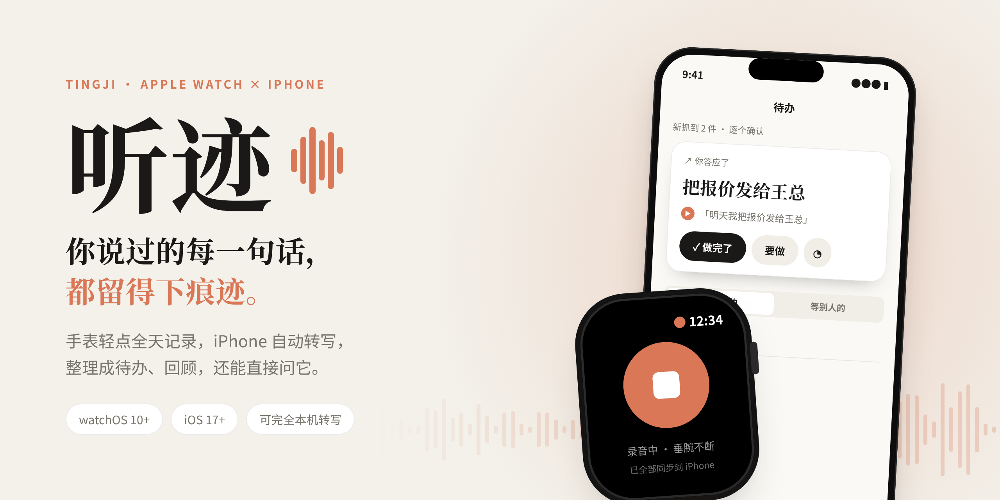
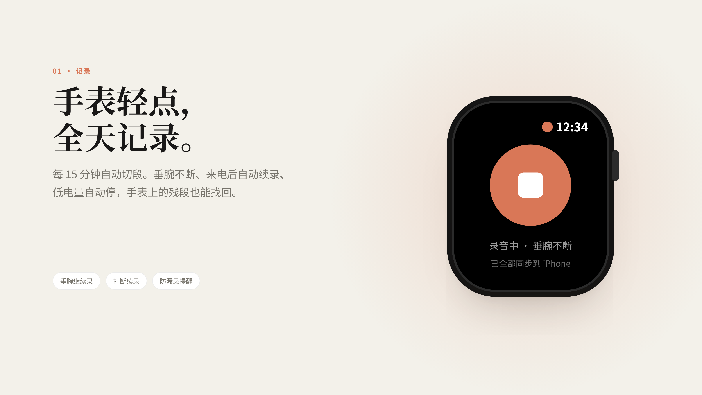
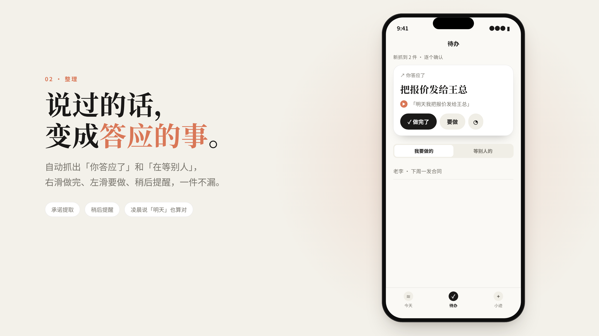
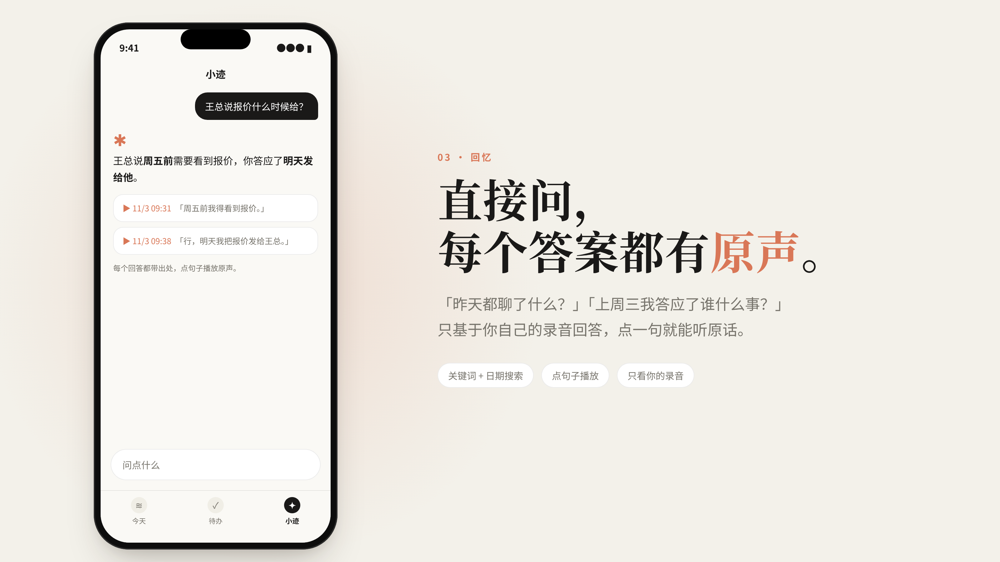
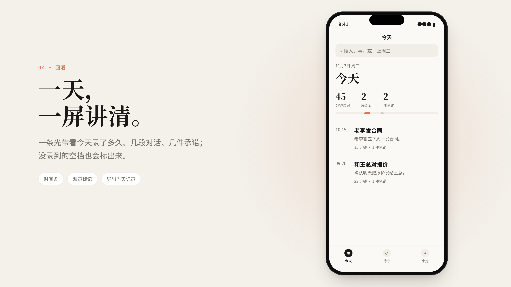
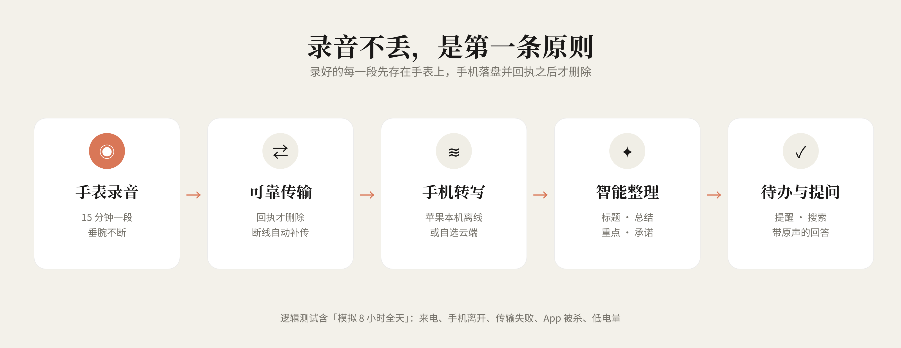

  <picture>
    <source media="(prefers-color-scheme: dark)" srcset="assets/tingji-banner-dark.png">
    
  </picture>

  <b>听迹</b> · Apple Watch 全天记录，iPhone 自动整理成待办、回顾，还能直接问它 
  watchOS 10+ · iOS 17+ · 可选本机转写  
  <a href="https://avacx.github.io/tingji-showcase/"><b>▶ 打开宣传页看完整视频</b></a>

  

## 它做什么

## 录音可靠，是第一条原则

每一段录音先存在手表上，手机收到并确认后才从手表删除；断线时留在手表，连上再补传。

---

> **说明**：听迹目前处于开发验证阶段，尚未上架。图和视频中的界面、人名和对话为演示内容，不是真实录音；续航与长时间录音表现仍在实测中。本仓库只包含宣传素材，不含应用源码。
